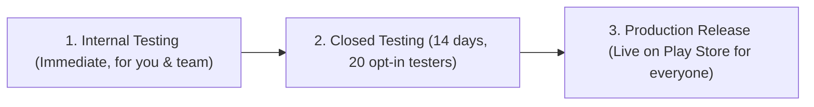

# Google Play Store Publishing Guide for AutoORB

This guide outlines the exact, step-by-step process to publish **AutoORB** to the **Google Play Store** with zero monthly operational costs.

---

## 1. Prerequisites

1. **Google Play Console Developer Account**:
   - Register at [play.google.com/console](https://play.google.com/console).
   - Requires a one-time registration fee of **\$25** (no recurring or monthly charges).
2. **GitHub Repository**:
   - Push your code to GitHub to use the free **GitHub Actions** builder (2,000 build minutes/month for free).

---

## 2. Automated Cloud Build Pipeline (No Android Studio Required!)

We have configured an automated GitHub Actions CI/CD workflow at:
`.github/workflows/build_android.yml`

### How to trigger a build:
1. Push your code to your GitHub repo:
   ```bash
   git add .
   git commit -m "Configure native Android app and CI/CD"
   git push origin main
   ```
2. Navigate to your repository on GitHub -> **Actions** tab.
3. The **"Build AutoORB Android App (APK & AAB)"** workflow will run automatically.
4. When finished (usually 3–4 minutes), download the artifacts:
   - `AutoORB-debug-apk`: Install directly on your physical Android phone for immediate testing.
   - `AutoORB-playstore-aab`: Upload directly to the Google Play Console.

---

## 3. Creating a Release Signing Keystore

Before publishing to production, Google requires an Android upload keystore:

Run this command in PowerShell or terminal:
```bash
keytool -genkey -v -keystore autoorb-release-key.jks -keyalg RSA -keysize 2048 -validity 10000 -alias autoorb-key
```
> [!IMPORTANT]
> Keep `autoorb-release-key.jks` and your keystore password safe. Back it up in Google Drive or offline storage.

Add the keystore to your GitHub Secrets if you want GitHub Actions to sign the `.aab` automatically:
- `ANDROID_KEYSTORE_BASE64`
- `ANDROID_KEYSTORE_PASSWORD`
- `ANDROID_KEY_ALIAS`
- `ANDROID_KEY_PASSWORD`

---

## 4. Google Play Store Compliance Checklist for Trading Apps

Google Play has strict policies for **Financial / Algorithmic Trading Apps**. Ensure these items are ready:

### 1. Privacy Policy
Google Play mandates a publicly accessible Privacy Policy URL. You can host this for free on GitHub Pages, Cloudflare Pages, or Google Sites.
- State clearly that broker credentials (API keys, tokens) are encrypted using AES-256 and never shared with third parties.

### 2. SEBI / Financial Risk Disclaimer
Must be visible inside the app and in the store description:
> *"Trading in equities, futures, and options involves substantial risk of loss and is not suitable for every investor. AutoORB is an automated execution software terminal that interfaces with registered brokers (Finvasia Shoonya) via official APIs. Past backtest performance does not guarantee future results."*

### 3. Financial Features Declaration in Console
In the Google Play Console under **Policy -> Financial Features**:
- Select: **Stock / Trading tools**.
- Declare that the app does not accept deposits or lend money directly (it interfaces via broker API).

---

## 5. Testing & Production Rollout Stages

Google requires all personal developer accounts to run a test track before production:



1. **Internal Testing**:
   - Upload `app-release.aab`.
   - Add your email and friends' emails to the tester list.
   - Testers receive a private Play Store link and can download immediately without waiting for Google review!
2. **Closed Testing**:
   - Required by Google for new personal accounts (20 testers opted in for 14 days).
3. **Production**:
   - Click "Promote to Production". Google reviews the app within 24–48 hours, after which AutoORB is live globally on Google Play!
